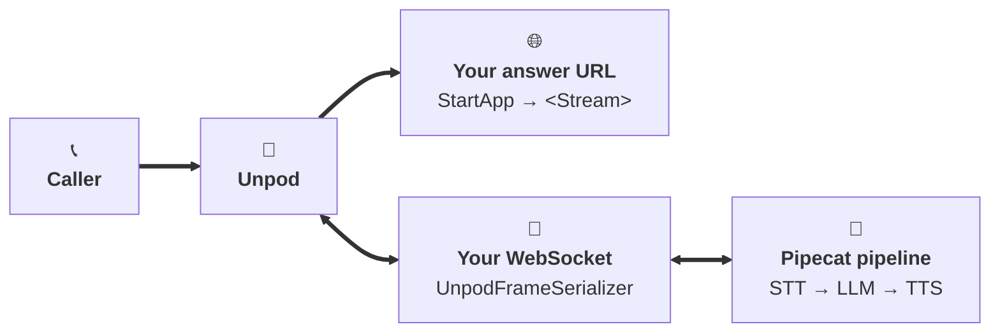

# Pipecat bots on Unpod calls

> Put your own Pipecat voice bot on an Unpod call. Unpod streams the call's audio to your
> WebSocket; `UnpodFrameSerializer` turns it into Pipecat frames and your bot's audio back
> into Unpod messages.

This is the Pipecat walkthrough for [Audio Streaming](https://docs.unpod.ai/telephony/apis/audio-streaming).
That page is the reference for the `<Stream>` verb, the REST stream API, the WebSocket
protocol and its signature; here you wire it into a Pipecat bot.

| | Realtime / WebSocket sessions | Audio streaming + Pipecat |
| --- | --- | --- |
| Who runs STT, VAD, TTS | Unpod | Your Pipecat pipeline |
| Your code sees | Text | Audio frames, via `UnpodFrameSerializer` |
| How a call reaches it | Number attached to an agent | `<Stream>` in your answer URL reply, or `calls.start_stream()` |

> [!NOTE]
>
> Preview. Your org needs the Call API switched on (otherwise `403 call_api_disabled`) and
> audio streaming switched on (otherwise a `<Stream>` is skipped and the REST stream API
> returns `403`). Ask the Unpod team for both. The Python pieces on this page ship in the
> `unpod` release after 0.7.0.



## What the serializer does

Unpod sends JSON frames over the WebSocket, one `media` frame about every 20 ms. Pipecat
works with frames of its own: audio, key presses, "stop talking", "conversation over".
`UnpodFrameSerializer` translates both ways:

| Unpod sends | Your pipeline gets |
| --- | --- |
| `media` (caller audio) | `InputAudioRawFrame` at your pipeline's sample rate |
| `dtmf` | `InputDTMFFrame` |

| Your pipeline produces | Unpod gets |
| --- | --- |
| `OutputAudioRawFrame` (bot speech) | `playAudio`: the caller hears it |
| `InterruptionFrame` (caller barged in) | `clearAudio`: audio not yet played is dropped |
| `EndFrame` / `CancelFrame` | the call is hung up with `calls.hangup(call_id)` |

It reads the format from `start.mediaFormat` (μ-law, A-law or L16), resamples to your
pipeline's rate, and feeds only `inbound` audio to the pipeline, so the bot never hears
itself. Everything else is plain Pipecat.

## Stream your first call

1. Credentials and install

Export `UNPOD_BASE_URL`, `UNPOD_PLATFORM_TOKEN` and `UNPOD_ORG_HANDLE` as in
[Credentials](https://docs.unpod.ai/telephony/apis/quickstart). Python 3.12+.

```bash
python3 -m venv .venv
source .venv/bin/activate
pip install "unpod[pipecat]" "pipecat-ai[websocket,silero,deepgram,anthropic,cartesia]" fastapi uvicorn
```

The bot below uses Deepgram, Anthropic and Cartesia: export `DEEPGRAM_API_KEY`,
`ANTHROPIC_API_KEY` and `CARTESIA_API_KEY`, or swap in any Pipecat services.

2. A number and the webhook secret

Attach a number with `attach_type="human_call"` so your app answers it, and store your
org's webhook secret as `UNPOD_WEBHOOK_SECRET`. Both are in the
[Quick Start](https://docs.unpod.ai/telephony/apis/quickstart).

> [!WARNING]
>
> `webhook_secret.rotate()` invalidates the previous secret. If your org already has one,
> reuse it (`webhook_secret.reveal()`, org admin) instead of rotating.

Unpod signs inbound answer-URL requests and every stream WebSocket upgrade with this
secret, so your server can refuse anything that isn't Unpod.

3. Run the server

One app, three routes: `/answer` (inbound answer URL), `/outbound` (answer URL for calls
you place) and `/ws` (the stream). Save as `app.py`:

```python
import os

import uvicorn
from fastapi import FastAPI, HTTPException, Request, Response, WebSocket
from pipecat.audio.vad.silero import SileroVADAnalyzer
from pipecat.frames.frames import LLMRunFrame
from pipecat.pipeline.pipeline import Pipeline
from pipecat.pipeline.worker import PipelineParams, PipelineWorker
from pipecat.processors.aggregators.llm_context import LLMContext
from pipecat.processors.aggregators.llm_response_universal import (
    LLMContextAggregatorPair,
    LLMUserAggregatorParams,
)
from pipecat.services.anthropic.llm import AnthropicLLMService
from pipecat.services.cartesia.tts import CartesiaTTSService
from pipecat.services.deepgram.stt import DeepgramSTTService
from pipecat.transports.websocket.fastapi import (
    FastAPIWebsocketParams,
    FastAPIWebsocketTransport,
)
from pipecat.workers.runner import WorkerRunner

from unpod import AsyncClient
from unpod.pipecat import (
    UnpodFrameSerializer,
    parse_unpod_websocket,
    verify_stream_request,
)
from unpod.telephony import WebhookSignatureError, parse_call_event
from unpod.telephony.answer import Response as Answer
from unpod.telephony.stream import NonceCache

SECRET = os.environ["UNPOD_WEBHOOK_SECRET"]
PUBLIC_HOST = os.environ["PUBLIC_HOST"]  # e.g. abc123.ngrok.app
STREAM_URL = f"wss://{PUBLIC_HOST}/ws"
NONCES = NonceCache()  # one per process: blocks replayed upgrades
app = FastAPI()
unpod = AsyncClient()


def stream_reply() -> Response:
    xml = Answer().stream(STREAM_URL).to_xml()
    return Response(xml, media_type="application/xml")


@app.post("/answer")
async def answer(request: Request):
    try:
        ev = parse_call_event(await request.body(), request.headers, secret=SECRET)
    except WebhookSignatureError:
        raise HTTPException(401)
    if ev.event == "StartApp":  # a new call: stream it to the bot
        return stream_reply()
    return Response(status_code=200)  # Hangup / RecordStop: acknowledge


@app.post("/outbound")
async def outbound(request: Request):
    ev = parse_call_event(await request.body(), request.headers, secret=SECRET)
    if ev.event == "StartApp":  # the person answered
        return stream_reply()
    return Response(status_code=200)


@app.websocket("/ws")
async def ws(websocket: WebSocket):
    # Only Unpod can sign the upgrade with your webhook secret.
    if not verify_stream_request(
        websocket.headers,
        SECRET,
        url=str(websocket.url),
        public_base=f"wss://{PUBLIC_HOST}",  # the tunnel: your server sees its own host
        nonce_cache=NONCES,
    ):
        await websocket.close(code=1008)
        return
    await websocket.accept()
    start = await parse_unpod_websocket(websocket)  # call id, stream id, audio format

    transport = FastAPIWebsocketTransport(
        websocket=websocket,
        params=FastAPIWebsocketParams(
            audio_in_enabled=True,
            audio_out_enabled=True,
            add_wav_header=False,
            serializer=UnpodFrameSerializer.from_start(start, client=unpod),
        ),
    )

    stt = DeepgramSTTService(api_key=os.environ["DEEPGRAM_API_KEY"])
    llm = AnthropicLLMService(
        api_key=os.environ["ANTHROPIC_API_KEY"],
        settings=AnthropicLLMService.Settings(
            model="claude-haiku-5-5",
            system_instruction="You are a friendly assistant on a phone call. "
            "Answer in one or two short spoken sentences.",
        ),
    )
    tts = CartesiaTTSService(
        api_key=os.environ["CARTESIA_API_KEY"],
        settings=CartesiaTTSService.Settings(
            voice="71a7ad14-091c-4e8e-a314-022ece01c121"
        ),
    )
    context = LLMContext()
    user, assistant = LLMContextAggregatorPair(
        context, user_params=LLMUserAggregatorParams(vad_analyzer=SileroVADAnalyzer())
    )
    worker = PipelineWorker(
        Pipeline(
            [transport.input(), stt, user, llm, tts, transport.output(), assistant]
        ),
        params=PipelineParams(audio_in_sample_rate=8000, audio_out_sample_rate=8000),
    )
    runner = WorkerRunner(handle_sigint=False)
    await runner.add_workers(worker)

    @transport.event_handler("on_client_connected")
    async def greet(transport, client):
        context.add_message(
            {"role": "user", "content": "Greet the caller in one short sentence."}
        )
        await worker.queue_frames([LLMRunFrame()])

    @transport.event_handler("on_client_disconnected")
    async def gone(transport, client):
        await runner.cancel()  # the caller hung up

    await runner.run()


if __name__ == "__main__":
    uvicorn.run(app, host="127.0.0.1", port=8000)
```

Run it with `python app.py`. It refuses unsigned requests and upgrades, streams each new
call to `/ws`, and hangs the call up when the bot ends.

4. Expose it

Unpod calls only public https URLs and streams only to a public `ws://` / `wss://` host. In
a second terminal:

```bash
ngrok http 8000
```

Set `PUBLIC_HOST` to the forwarding host (e.g. `abc123.ngrok.app`) and restart `app.py`.

5. Point your number at it, or call out

Inbound, once per number:

```python
from unpod import Client
from unpod.telephony import InboundConfig

URL = "https://abc123.ngrok.app/answer"

with Client() as client:
    client.telephony.inbound.set_did(
        "+919000000001",
        InboundConfig(
            answer_url=URL,
            answer_method="POST",
            status_callback_url=URL,
        ),
    )
```

```bash
curl -s -X PUT "https://unpod.ai/api/v2/platform/sbc/v1/dids/%2B919000000001/inbound" \
  -H "Authorization: Token $UNPOD_PLATFORM_TOKEN" -H "Org-Handle: $UNPOD_ORG_HANDLE" \
  -H "Content-Type: application/json" \
  -d '{"answer_url": "https://abc123.ngrok.app/answer", "answer_method": "POST",
       "status_callback_url": "https://abc123.ngrok.app/answer"}'
```

Outbound, per call:

```python
from unpod import Client

with Client() as client:
    call = client.telephony.calls.create(
        "+919000000001",  # your Unpod number
        "+919000000002",  # who to call
        answer_url="https://abc123.ngrok.app/outbound",
        answer_method="POST",
    )
    print("calling", call.call_id)
```

```bash
curl -s -X POST "https://unpod.ai/api/v2/platform/sbc/v1/calls" \
  -H "Authorization: Token $UNPOD_PLATFORM_TOKEN" -H "Org-Handle: $UNPOD_ORG_HANDLE" \
  -H "Idempotency-Key: $(uuidgen)" -H "Content-Type: application/json" \
  -d '{"from": "+919000000001", "to": "+919000000002",
       "answer_url": "https://abc123.ngrok.app/outbound", "answer_method": "POST"}'
```

6. Talk to it

Call your number, or pick up the outbound call. The bot greets you; talk and it answers.
Hang up and Unpod closes the WebSocket, which stops the pipeline. If the bot ends first
(an `EndFrame`), the serializer hangs the call up.

## Stream a call that is already up

You don't need the answer URL to stream: `calls.start_stream()` attaches a stream to a live
call, for example halfway through, and `stop_stream()` ends it while the call carries on.
Your `/ws` route is the same.

```python
async with AsyncClient() as client:
    calls = client.telephony.calls
    started = await calls.start_stream(
        call_id,
        "wss://abc123.ngrok.app/ws",
        bidirectional=True,
        content_type="audio/x-mulaw;rate=8000",
        status_callback_url="https://abc123.ngrok.app/stream-events",
    )
    print(started.stream_id)

    await calls.stop_stream(call_id)  # the call carries on
```

One stream per call at a time. See the
[REST stream API](https://docs.unpod.ai/telephony/apis/audio-streaming).

## `Answer().stream()` for a voice bot

`Answer().stream(url)` is set up for a two-way voice bot. Unpod's own defaults for a bare
`<Stream>` are different, so it sends:

| SDK argument | SDK default | Unpod default for a bare `<Stream>` | Why the SDK changes it |
| --- | --- | --- | --- |
| `bidirectional` | `True` | `false` | The bot has to talk back |
| `keep_call_alive` | `True` | `false` | With `false` and nothing after `<Stream>`, the call ends at once (`End Of XML Instructions`) |
| `audio_track` | `"inbound"` | `inbound` | The bot hears the caller. `bidirectional` needs `inbound` |
| `content_type`, `sample_rate` | μ-law, 8000 | `audio/x-l16;rate=8000` | μ-law at 8 kHz is the phone's own format: no transcoding |

```xml
<Response>
    <Stream bidirectional="true" keepCallAlive="true" audioTrack="inbound"
            contentType="audio/x-mulaw;rate=8000">wss://abc123.ngrok.app/ws</Stream>
</Response>
```

It also takes `stream_timeout=`, `status_callback_url=`, `status_callback_method=`,
`extra_headers=` (a string or a dict) and the noise-cancellation options. Chain more verbs
after it, for example `.dial(...)` to hand the caller to a person once the bot closes the
socket: `Answer().stream(url).dial("+919000000003").to_xml()`. Every attribute is in the
[verb reference](https://docs.unpod.ai/telephony/apis/audio-streaming).

## `UnpodFrameSerializer`

```python
UnpodFrameSerializer.from_start(start, client=unpod)
```

`start.call_id` is the id the call APIs take, so the serializer can hang up with it.

| Argument | Default | Meaning |
| --- | --- | --- |
| `client` | - | `AsyncClient`. Hangup is `client.telephony.calls.hangup(start.call_id)` |
| `hangup` | - | Your own `async def hangup(call_id)`, instead of `client` |
| `params=InputParams(auto_hang_up=...)` | `True` | Hang up once on `EndFrame` / `CancelFrame`. A call that already ended (404, 409, 410) is ignored. Needs `client` or `hangup`; set `False` if your app ends calls itself |
| `params=InputParams(output_format=...)` | the stream's format | Format of `playAudio` |

Keep the pipeline at 8000 Hz for μ-law calls to skip resampling; any other rate works.

## Verify the stream

`verify_stream_request` checks the `X-Unpod-Signature` header on the upgrade before you
accept the socket:

| Argument | Meaning |
| --- | --- |
| `url=str(websocket.url)` | The URL is part of what Unpod signs |
| `public_base="wss://your-host"` | Behind ngrok or a proxy your server sees its own host and often `ws://`. The host is taken from here, never from request headers |
| `nonce_cache=NonceCache()` | One per process. Refuses a signature seen in the last 10 minutes (replays) |
| `tolerance` | Max age of the signature in seconds (default 300) |

Close the socket with `1008` when it returns `False`. Unpod then reports the stream as
`failed` / `authentication_failed`. The signature format, for other languages, is under
[Verify the stream signature](https://docs.unpod.ai/telephony/apis/audio-streaming).

## Stream events

With `status_callback_url=` on `Answer().stream()` or `start_stream()`, Unpod posts
`started`, `stopped`, `failed` and `degraded` (your bot reads audio too slowly). They are
signed like every webhook:

```python
from unpod.telephony import STREAM_EVENTS, parse_call_event

ev = parse_call_event(body, headers, secret=SECRET)
if ev.event in STREAM_EVENTS:
    print(ev.event, ev.stream_id, ev.stream_reason, ev.error)
```

## Troubleshooting

| Symptom | Likely cause |
| --- | --- |
| Answer URL hit, no WebSocket | Audio streaming is off for your org, or the stream URL isn't a public host |
| Socket closed with `1008`, stream `failed` / `authentication_failed` | Wrong secret, `public_base` not set behind a tunnel, or the server clock is more than 300 s off |
| Call ends the moment it is answered | `keep_call_alive=False` with nothing after `<Stream>` |
| Bot can't be heard | `bidirectional=False`, or the pipeline produces no `OutputAudioRawFrame` |
| Bot hears itself | `audio_track="both"` with a custom serializer. `UnpodFrameSerializer` drops `outbound` audio |
| Bot hears noise | Your code decodes a different format than `start.mediaFormat`. `from_start()` reads it for you |
| Bot cut off mid-call, `failed` / `slow_connection` | The pipeline stopped reading audio (blocked event loop); `degraded` callbacks come first |
| Call stays up in silence after the bot ends | `auto_hang_up=False` and your app didn't hang up |

## Next

- [`examples/pipecat_streaming/`](../examples/pipecat_streaming/): a full inbound and
  outbound example server.
- [Audio Streaming](https://docs.unpod.ai/telephony/apis/audio-streaming): the verb, REST
  stream API, protocol and signature in full.
- [Answer URL & XML](https://docs.unpod.ai/telephony/apis/answer-url): every verb you can
  put before or after `<Stream>`.
- [Incoming Calls](https://docs.unpod.ai/telephony/apis/incoming-calls): routing, the
  webhook secret and fallbacks.
- [Multiple Participants](https://docs.unpod.ai/telephony/apis/multiple-participants):
  bring a person into the bot's call.
- [Recording](https://docs.unpod.ai/telephony/apis/recording): get the call audio
  afterwards.
